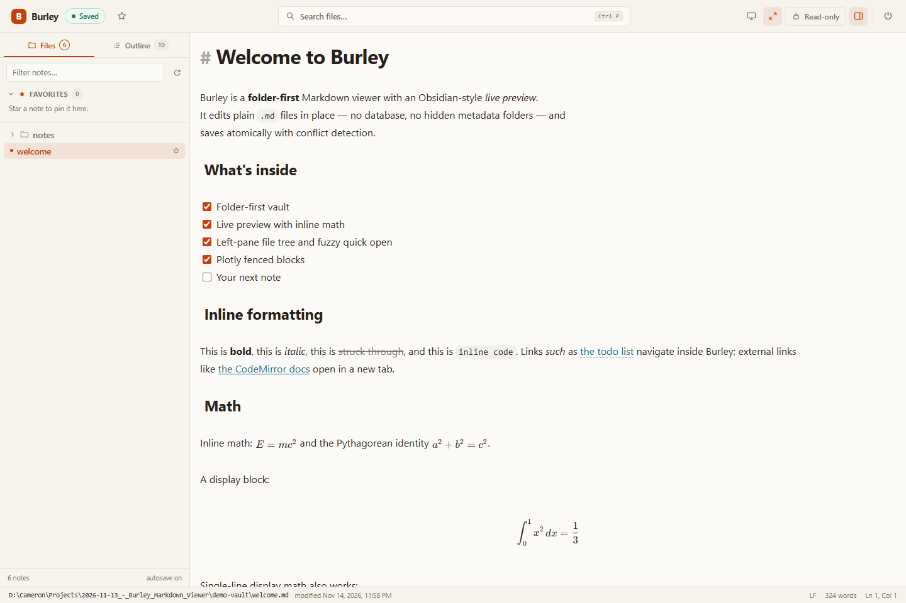
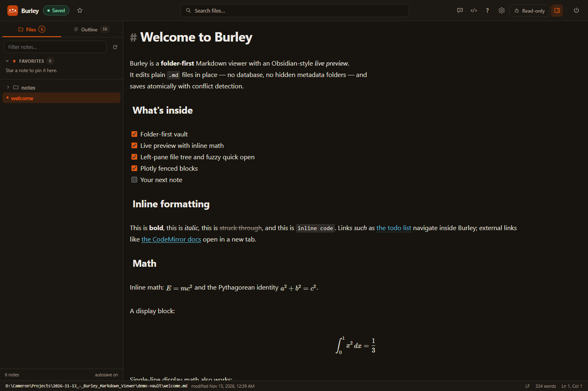
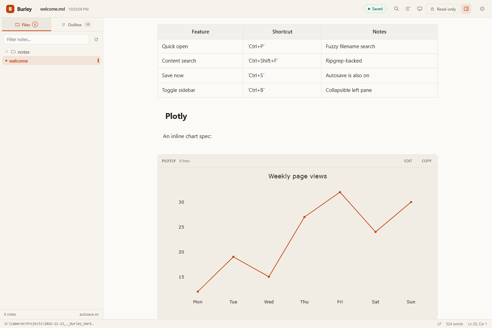

# Burley

A fast, folder-first Markdown viewer and live-preview editor for a plain folder of
`.md` files — locally or on an EC2 box reached over an SSH tunnel.

Burley edits the files in place. There is no database and no hidden metadata
folder; the Markdown file on disk is the source of truth. The Go backend embeds
the compiled frontend, so deployment is a single executable.








---

## Features

- **Obsidian-style live preview** (CodeMirror 6 + `codemirror-live-markdown`):
  headings, emphasis, links, blockquotes, GFM tables and task checkboxes render
  inline; raw Markdown appears only when the cursor enters an element. List
  markers stay visible as bullets (•/◦/▪) and numbers instead of disappearing.
- **Lossless saves:** the plain-text buffer is edited directly, files are written
  atomically (temp file + rename), and the original line endings (LF/CRLF), BOM
  and trailing newline are preserved.
- **Conflict detection:** saves send the last seen SHA-256. If the file changed
  on disk, the API returns `409` with the server copy and the UI asks whether to
  keep yours, take theirs, or decide later.
- **Left file tree + fast search:** collapsible tree with filter, `Ctrl+P` fuzzy
  filename jump (fuzzysort), and `Ctrl+Shift+F` full-text search (ripgrep with a
  pure-Go fallback).
- **Files | Outline tabs:** Typora-style tabs at the top of the left sidebar;
  the outline lists the note's headings (indented, code fences excluded) and
  clicking one jumps to it.
- **Resizable sidebar:** drag the divider (220–560 px), use arrow keys when it
  is focused, or double-click to reset; the width is remembered.
- **Math and charts offline:** KaTeX for `$...$` / `$$...$$`, plus a plugin
  registry for fenced blocks. ```` ```plotly ```` accepts inline JSON or
  `src: ./data.json`; Plotly is lazily loaded and charts stay interactive.
- **Relative assets:** `` and chart data files resolve against
  the note's folder and are served through `/api/asset`.
- **Read-only lock:** browse without a caret or accidental edits.
- **Dark mode:** follows the OS preference by default; the top-bar toggle cycles
  system → light → dark and is remembered.
- **Narrow/wide reading mode:** one click widens the editor to 1200 px with
  tighter gutters (820 px when narrow); remembered between sessions.
- **Favorites with YAML storage:** star notes from the top bar or tree rows.
  They appear above the file tree with their own fuzzy filter, at the top of an
  empty `Ctrl+P`, survive reloads, and are stored cross-device in
  `.burley/favorites.yaml` via `GET`/`PUT /api/favorites` (not in your Markdown
  folder's tracked files). Missing favorites are dimmed with a remove button;
  favorites can be drag-reordered.
- **One-click Quit + port increment:** `POST /api/quit` gracefully stops the
  server. If the preferred port is busy, Burley tries the next 20 ports and then
  an OS-assigned port, logging the URL actually used.

---

## Quick start

### Windows

```powershell
./scripts/build.ps1
./bin/burley.exe --root ./demo-vault
```

### macOS / Linux

```bash
make build
./bin/burley --root ./demo-vault
```

Then open <http://127.0.0.1:8080>. If that port is busy, the console prints the
next free port (for example `http://127.0.0.1:8081`).

`--root` accepts any folder:

```bash
./bin/burley --root /srv/notes --addr 127.0.0.1:8080
```

Stop with `Ctrl+C` or the **Quit** button (red power icon, top right).

---

## Development

Run the Go API and the Vite dev server side by side. Vite proxies `/api` to
`127.0.0.1:8080`.

```bash
# terminal 1
go run ./cmd/server --root ./demo-vault --addr 127.0.0.1:8080

# terminal 2
cd web
npm install
npm run dev          # http://localhost:5173
```

Type-check and test:

```bash
go test ./...
cd web && npm run check
```

The browser smoke test needs a running server and an installed Chrome/Edge:

```bash
# terminal 1 (from the repo root)
./bin/burley --root ./demo-vault

# terminal 2
cd e2e
npm install
npm run smoke
```

If the server picked a different port, point the test at it:
`BURLEY_URL=http://127.0.0.1:8081 npm run smoke`.

It exercises the tree layout, math, tables, task checkboxes, images, Plotly,
fuzzy/content search, autosave, CRLF preservation, conflict handling, read-only
mode, light/dark themes and the quit confirmation. Screenshots are written to
`e2e/`.

---

## Keyboard shortcuts

| Shortcut | Action |
| --- | --- |
| `Ctrl+P` / `Cmd+P` | Fuzzy quick-open by filename |
| `Ctrl+Shift+F` / `Cmd+Shift+F` | Full-text content search |
| `Ctrl+S` / `Cmd+S` | Save now (autosave runs 1.5 s after typing stops) |
| `Ctrl+B` / `Cmd+B` | Toggle the file tree |
| `Ctrl+Shift+R` | Reload the folder tree |
| `Esc` | Close search / dialogs |

---

## Content syntax

### Math

```markdown
Inline: $E = mc^2$

$$
\int_0^1 x^2\,dx = \frac{1}{3}
$$
```

### Plotly

Inline spec:

````markdown
```plotly
{
  "data": [{ "type": "scatter", "x": [1, 2, 3], "y": [4, 1, 6] }],
  "layout": { "title": "Example" }
}
```
````

Or a relative JSON file:

````markdown
```plotly
src: ./data/results.json
```
````

Move the caret into the block to edit it; move out to render again. The block
header has **Edit** and **Copy** buttons.

### Tasks, tables, links

```markdown
- [x] Completed
- [ ] Open

| Column A | Column B |
| --- | --- |
| one | two |

See [the todo list](./notes/todo.md).
```

---

## HTTP API

| Method & path | Purpose |
| --- | --- |
| `GET /api/health` | Status, vault root, ripgrep availability |
| `GET /api/tree` | Nested `tree` plus flat `files` list |
| `GET /api/file?path=...` | File content, `modTime`, SHA-256 `hash` |
| `PUT /api/file` | `{path, content, expectedHash}`; `409` returns the current file |
| `GET /api/asset?path=...` | Images / JSON / CSV and other whitelisted assets |
| `GET /api/search?q=...` | Content search results (`path`, `line`, `snippet`) |
| `GET /api/favorites` | Read `.burley/favorites.yaml` |
| `PUT /api/favorites` | Replace the favorite list (`{favorites:[...]}`) |
| `POST /api/quit` | Graceful shutdown (loopback clients only) |

Writes are atomic: a hidden temp file in the same directory is synced and then
renamed over the target, with the original permissions preserved.

---

## Deploying to EC2

Cross-compile a static Linux binary:

```bash
make linux
# bin/burley-linux-amd64
```

Copy it and install a service:

```bash
scp bin/burley-linux-amd64 ec2:/tmp/burley
ssh ec2 'sudo install -m 755 /tmp/burley /usr/local/bin/burley'
```

A ready-to-edit unit file lives at [`deploy/burley.service`](deploy/burley.service):

```bash
sudo cp deploy/burley.service /etc/systemd/system/
sudo systemctl daemon-reload
sudo systemctl enable --now burley
```

Then tunnel the port from your laptop:

```bash
ssh -N -L 8080:localhost:8080 user@your-ec2-host
# browse http://127.0.0.1:8080
```

Install `ripgrep` on the server for the fastest content search; without it
Burley falls back to a pure-Go scan automatically.

---

## Security notes

- Binds to `127.0.0.1` by default; remote access is gated by SSH.
- Every path is canonicalised and checked against the vault root; `..`,
  absolute paths, Windows drive paths and symlinks escaping the root are
  rejected with `400`/`403`.
- Assets are restricted to a MIME whitelist (images, JSON, CSV/TSV, text, PDF,
  video) and served with `nosniff` + a sandbox CSP.
- The frontend ships with a strict CSP; all assets (KaTeX fonts, Plotly) are
  bundled, so notes make no CDN requests.
- `/api/quit` is loopback-only.

---

## Project layout

```text
cmd/server/          CLI, embedded frontend, port fallback, graceful shutdown
internal/vault/      Vault interface + LocalVault (atomic writes, path safety)
internal/api/        REST handlers, static serving, quit endpoint
web/                 Svelte 5 + Vite + TypeScript frontend
  src/lib/           editor, math, images, links, tasks, outline, block plugins, theme
  src/components/    FileTree, SearchModal, ConflictModal
e2e/                 Playwright smoke test
demo-vault/          Sample notes, images and Plotly data
deploy/              systemd unit
scripts/             Windows build script
```

The specification lives in [`PROJECT_SPEC.md`](PROJECT_SPEC.md).
