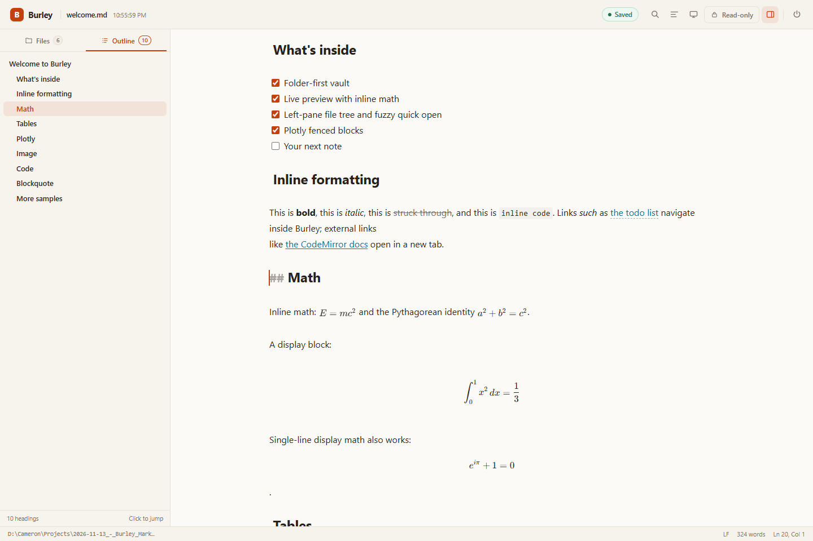
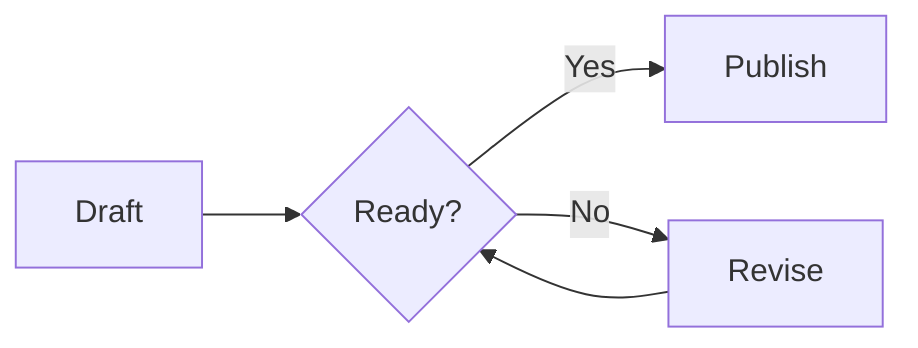

# Burley

[](https://github.com/CameronEllum/burley/actions/workflows/ci.yml)
[](LICENSE)
[](https://vibecoded.fyi/)
[](https://vibecoded.fyi/)
[](https://vibecoded.fyi/)

A fast, folder-first Markdown viewer and live-preview editor for a plain folder of
`.md` files — locally or on a remote host reached over an SSH tunnel.

Burley edits the files in place. There is no database and no hidden metadata
folder; the Markdown file on disk is the source of truth. The Go backend embeds
the compiled frontend, so deployment is a single executable.




---

## Features

- **Obsidian-style live preview** (CodeMirror 6 + `codemirror-live-markdown`):
  headings, emphasis, links, blockquotes, GFM tables and task checkboxes render
  inline; raw Markdown appears only when the cursor enters an element. List
  markers stay visible as bullets (•/◦/▪) and numbers instead of disappearing.
- **YAML properties card:** a leading frontmatter block folds into a compact
  card with tag chips, nested maps and clickable links; click a row or **Edit**
  to reveal the raw YAML in place, then move out to fold it back.
- **Editable tables:** click a cell to edit it (Tab/Shift+Tab, arrows, Enter),
  hover for + row / + column controls, cycle column alignment, and add/remove
  rows or columns. Only the table range is rewritten, so the rest of the note is
  untouched.
- **Highlighted code blocks:** fenced code renders with highlight.js colors;
  editing the raw fence switches to a monospace source style.
- **Image paste & drop:** paste a screenshot or drop an image file into the
  editor and Burley stores it in `<note>_assets/` next to the note, inserting a
  relative `` reference at the caret.
- **Folder scoping:** right-click a folder in the tree and choose **Scope to
  here** to restrict the browser to that subtree; **Unscope** returns to the
  whole vault. The scope survives reloads.
- **Add document:** right-click a folder and choose **Add document** to name and
  create a new note in that folder (or at the vault root) and open it.
- **Lua live cells:** fenced ```` ```lua-run ```` cells get a **▶ Run** button
  and an output panel directly below the fence. Lua 5.4 runs in a sandboxed WASM
  VM inside a Web Worker (`wasmoon`), one VM per note with a 5-second timeout,
  and never writes output into the Markdown file. Cells can `print()`, return
  text, Markdown/KaTeX, tables, JSON or sanitized HTML, and read the vault
  through a read-only `vault.list/read/search` bridge.
- **Spellcheck:** optional native browser spellchecking, enabled from Settings;
  code fences, inline code, math and URLs are excluded from squiggles.
- **Lossless saves:** the plain-text buffer is edited directly, files are written
  atomically (temp file + rename), and the original line endings (LF/CRLF), BOM
  and trailing newline are preserved.
- **Conflict detection:** saves send the last seen SHA-256. If the file changed
  on disk, the API returns `409` with the server copy and the UI asks whether to
  keep yours, take theirs, or decide later.
- **Left file tree + quick-open palette:** collapsible tree with filter; a wide,
  centered quick-open box (`Ctrl+P` / `F1`) opens a palette with favorites,
  recents, `@` heading jumps, `>` commands, and `?` full-text search. Recents are
  stored in `.burley/recent.yaml` and stale paths are filtered against the tree.
  Large folders populate progressively: the tree paints each batch the server
  has scanned and refreshes every second until the footer's `scanning…` badge
  disappears.
- **Links:** a plain click opens a link; **Ctrl/Cmd-click** reveals its Markdown
  source for editing.
- **Status bar:** the full file path and last-modified time live at the bottom,
  along with word count, caret position, and an update pill when a newer release
  exists (the top bar stays uncluttered).
- **Settings page:** gear icon with Behaviour (auto-save, Ctrl-click behavior,
  spellcheck) and Appearance (mode, light theme, dark theme, width, Markdown
  style: Default / GitHub / Academic / Compact) tabs. Stored in
  `.burley/settings.yaml`.
- **Raw mode:** `</>` toggles source view without losing cursor, scroll or undo;
  `Escape` exits the element under the caret.
- **Talk (CLI agents):** detect `claude`, `codex`, `gemini`, or `opencode`, then
  chat in a right-side panel (Alt+T) in Ask/Edit mode with SSE streaming,
  Markdown/KaTeX replies, and insert-at-cursor code blocks.
- **Per-agent model pinning:** **Settings → Agents** lists each detected CLI and
  its models (OpenCode is enumerated with `opencode models`; the other CLIs take
  a typed model ID). Pin one per agent or leave it on **Agent default** to follow
  the CLI's own configuration. The pin applies to Talk and the selection sparkle
  bar, shows as a chip in both headers, and is stored per vault in
  `.burley/settings.yaml` (`agent_model_<id>`).
- **Selection sparkle bar:** when a CLI agent is available, selecting text in the
  editor floats a small action bar above it: **Explain · Summarize · Shorten ·
  Rewrite**, plus a free-text **Ask**. Answers stream into the popover; Rewrite
  previews a word-level diff with **Replace selection** / **Insert below**, and
  **Copy** / **Open in Talk** hand off the result. `Alt+Enter` opens the
  selection in Talk, `Esc` dismisses. Hidden entirely when no agent is detected.
- **Shortcut sheet:** `Ctrl+?` anywhere, `?` when not typing, or the `?` button.
- **Export:** download a self-contained HTML file (inline images/fonts, static
  Plotly SVG) or open the browser's Save-as-PDF dialog with print CSS.
- **Right-click delete:** a file tree context menu offers Delete, confirmed in a
  native HTML dialog; the tree, editor, and favorites update immediately.
- **Deep links & history:** the open file and heading live in the URL
  (`?file=…#heading`), so notes are bookmarkable and Back/Forward work.
- **Files | Outline tabs:** Typora-style tabs at the top of the left sidebar;
  the outline lists the note's headings (indented, code fences excluded) and
  clicking one jumps to it.
- **Resizable sidebar:** drag the divider (220–560 px), use arrow keys when it
  is focused, or double-click to reset; the width is remembered.
- **Math and charts offline:** KaTeX for `$...$` / `$$...$$`, plus a plugin
  registry for fenced blocks. ```` ```plotly ```` accepts inline JSON or
  `src: ./data.json`; Plotly is lazily loaded and charts stay interactive.
- **Mermaid diagrams:** ```` ```mermaid ```` fences render flowcharts, sequence
  diagrams, gantt charts and the rest of Mermaid inline. The renderer is
  lazy-loaded, follows the active UI theme, opens in the figure viewer with
  **⤢**, and exports as inline SVG.
- **Relative assets:** `` and chart data files resolve against
  the note's folder and are served through `/api/asset`.
- **Read-only lock:** browse without a caret or accidental edits.
- **UI themes:** two light palettes (Parchment, White) and two dark
  palettes (Ember, Black). Choose the light and dark theme in Settings →
  Appearance; the top-bar sun / moon / monitor button cycles follow-system →
  light → dark. Palettes are stored in `.burley/settings.yaml` and apply to the
  chrome, sidebar, dialogs and editor surfaces (Markdown styles stay separate).
- **GitHub integration & updates:** the Burley icon/name links to the GitHub
  repository, and the server checks the latest published release (cached, silent
  when offline). A newer release appears as a pill in the status bar linking to
  its notes. Settings → **About** shows the running version, lets you check
  again, links the repo/releases, lists the open-source credits, and offers
  **Report a bug** and **Request a feature** links prefilled with the relevant
  details (bug reports include the version and browser; also available as
  `>Report a bug` in the palette).
- **Figure gallery & lightbox:** the `⤢` button on any image or Plotly chart
  (or Alt-click an image, or a plain click in read-only mode) opens a full-screen
  viewer with every figure in the note, `←`/`→` navigation, wheel zoom, drag to
  pan and `0`/double-click to reset.
- **Narrow/wide reading mode:** one click widens the editor to 1200 px with
  tighter gutters (820 px when narrow); remembered between sessions.
- **Favorites with YAML storage:** star notes from the top bar or tree rows.
  They appear above the file tree, are filtered by the same **Filter notes…**
  box as the tree, sit at the top of an empty `Ctrl+P`, survive reloads, and are
  stored cross-device in `.burley/favorites.yaml` via `GET`/`PUT /api/favorites`
  (not in your Markdown folder's tracked files). Missing favorites are dimmed
  with a remove button; favorites can be drag-reordered.
- **Cross-device settings:** theme and reading width are saved in
  `.burley/settings.yaml` (`GET`/`PUT /api/settings`) so another browser or
  laptop picks them up.
- **One-click Quit + port increment:** `POST /api/quit` gracefully stops the
  server. If the preferred port is busy, Burley tries the next 20 ports and then
  an OS-assigned port, logging the URL actually used.

---

## Quick start

### Windows

```powershell
./scripts/build.ps1
./bin/burley.exe --root ./demo-vault
```

### macOS / Linux

```bash
make build
./bin/burley --root ./demo-vault
```

Then open <http://127.0.0.1:8080>. If that port is busy, the console prints the
next free port (for example `http://127.0.0.1:8081`).

`--root` accepts any folder:

```bash
./bin/burley --root /srv/notes --addr 127.0.0.1:8080
```

Stop with `Ctrl+C` or the **Quit** button (red power icon, top right).

---

## Development

Run the Go API and the Vite dev server side by side. Vite proxies `/api` to
`127.0.0.1:8080`.

```bash
# terminal 1
go run ./cmd/server --root ./demo-vault --addr 127.0.0.1:8080

# terminal 2
cd web
npm install
npm run dev          # http://localhost:5173
```

Type-check and test:

```bash
go test ./...
cd web && npm run check
```

Builds stamp the nearest git tag into the binary (`-X main.version=…`), so
`--version`, the update check, and Settings → About all agree with the published
release (`v0.0.2` → `0.0.2`). Untagged builds report `0.0.0-dev`.

The browser smoke test needs a running server and an installed Chrome/Edge:

```bash
# terminal 1 (from the repo root)
./bin/burley --root ./demo-vault

# terminal 2
cd e2e
npm install
npm run smoke
```

If the server picked a different port, point the test at it:
`BURLEY_URL=http://127.0.0.1:8081 npm run smoke`.

It exercises the tree layout, math, tables, task checkboxes, images, Plotly,
frontmatter cards, Lua cells, folder scoping, image uploads, fuzzy/content
search, autosave, CRLF preservation, conflict handling, read-only mode,
light/dark themes and the quit confirmation. Screenshots are written to `e2e/`.

---

## Keyboard shortcuts

| Shortcut | Action |
| --- | --- |
| `Ctrl+P` / `Cmd+P` / `F1` | Quick-open palette (favorites, recents, files) |
| `Ctrl+Shift+O` | Palette in `@` heading mode |
| `Ctrl+Shift+F` | Palette in `?` content-search mode |
| `Ctrl+?` | Keyboard-shortcut sheet (also `?` when not typing) |
| `Alt+T` | Toggle the Talk panel |
| `Ctrl+Click` / `Cmd+Click` | Reveal a rendered link's Markdown source |
| `Ctrl+Enter` | Open the highlighted file in a new tab |
| `Ctrl+S` / `Cmd+S` | Save now (autosave runs 1.5 s after typing stops) |
| `Ctrl+B` / `Cmd+B` | Toggle the file tree |
| `Ctrl+Shift+R` | Reload the folder tree |
| `Ctrl+Shift+Z` | Toggle Zen focus mode (`Esc` exits) |
| `/` on a blank line | Slash commands for a block template |
| `Alt+Enter` (with a sparkle bar open) | Send the selection to the Talk panel |
| `Alt+Click` an image | Open the figure viewer |
| `←` / `→` in the viewer | Previous / next figure (`Esc` closes) |
| `>Restart Lua VM` | Reset the sandboxed Lua VM from the `>` palette |
| `Esc` | Close search / dialogs / the selection bar |

---

## Content syntax

### Math

```markdown
Inline: $E = mc^2$

$$
\int_0^1 x^2\,dx = \frac{1}{3}
$$
```

### Plotly

Inline spec:

````markdown
```plotly
{
  "data": [{ "type": "scatter", "x": [1, 2, 3], "y": [4, 1, 6] }],
  "layout": { "title": "Example" }
}
```
````

Or a relative JSON file:

````markdown
```plotly
src: ./data/results.json
```
````

Move the caret into the block to edit it; move out to render again. The block
header has **Edit** and **Copy** buttons.

### Lua live cells

````markdown
```lua-run
print('hello from Lua')
return { markdown = '**Total:** $' .. (1 + 2 + 3) .. '$' }
```
````

Click **▶ Run** on the fence line. The cell body stays visible and is styled as
Lua source — monospace, bordered, and syntax-highlighted — while outputs render
in a panel beneath it. The first run compiles the bundled WASM VM (~1 s); later
cells in the same note reuse its globals. Output stays in the panel — the `.md`
file is never modified. Use **Restart Lua VM** in the `>` palette to drop globals
and start fresh.

Available inside a cell:

| Name | Behaviour |
| --- | --- |
| `print(...)` | Captured into the output panel |
| `vault.list(prefix?)` | `{path, name, size, modTime}` for notes under a prefix |
| `vault.read(path)` | Note text (raises on missing/forbidden paths) |
| `vault.search(query)` | `{path, line, column, text, snippet}` matches |
| `burley.notify(msg)` | Toast in the app |

Return values: a string/number renders as text, `{ markdown = "…" }` uses the
KaTeX pipeline, `{ table = { headers = {…}, rows = {{…}} } }` renders a table,
`{ json = … }` pretty-prints JSON, and `{ html = "…" }` is sanitized. Cells run
only when you click Run; a cell that takes longer than 5 s is terminated and the
VM restarts.

### Mermaid

````markdown

````

Move the caret into the block to edit the source; the diagram renders again
when the caret leaves. Diagrams also appear in the figure viewer and are
embedded as SVG in HTML/PDF exports.

### Tasks, tables, links```markdown
- [x] Completed
- [ ] Open

| Column A | Column B |
| --- | --- |
| one | two |

See [the todo list](./notes/todo.md).
```

---

## Security notes

- Binds to `127.0.0.1` by default; remote access is gated by SSH.
- Every path is canonicalised and checked against the vault root; `..`,
  absolute paths, Windows drive paths and symlinks escaping the root are
  rejected with `400`/`403`.
- Assets are restricted to a MIME whitelist (images, JSON, CSV/TSV, text, PDF,
  video) and served with `nosniff` + a sandbox CSP. Uploads accept images only,
  are capped at 32 MB, and are written inside `<note>_assets/` with sanitized
  names.
- The frontend ships with a strict CSP; all assets (KaTeX fonts, Plotly) are
  bundled, so notes make no CDN requests.
- `/api/quit` is loopback-only.
