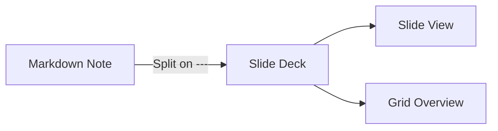

# Presentation Slides in Burley

Press **`F5`** (or click the **Present** button in the top bar) to launch Presentation Mode.

- Slides split on standalone `---` horizontal rules
- Press **`G`** for the slide grid overview
- Use **`←` / `→`** or **`Space`** to navigate, **`Esc`** to exit

---

## Clean Formatting & Math

Every slide supports full Markdown, tables, and KaTeX:

$$
\text{Speedup} = \frac{1}{(1 - p) + \frac{p}{s}}
$$

| Control | Action |
| :--- | :--- |
| `F5` | Start presentation |
| `G` | Toggle slide grid |
| `←` / `→` | Previous / Next slide |
| `Esc` | Exit presentation |

---

## Interactive Plotly Charts

Hover over any chart in Presentation Mode for tooltips and the zoom/pan toolbar:

```plotly
{
  "data": [
    {
      "type": "bar",
      "name": "Cold Scan",
      "x": ["1k notes", "5k notes", "20k notes"],
      "y": [45, 220, 950]
    },
    {
      "type": "bar",
      "name": "Warm Cache",
      "x": ["1k notes", "5k notes", "20k notes"],
      "y": [1, 2, 4]
    }
  ],
  "layout": {
    "title": "Startup Tree Load (ms)",
    "barmode": "group"
  }
}
```

---

## Mermaid Diagrams

Diagrams render crisply inside slides too:


